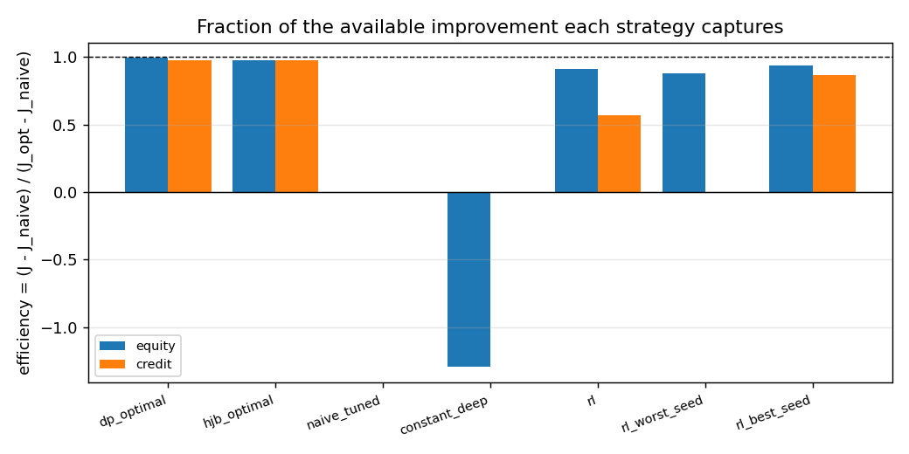
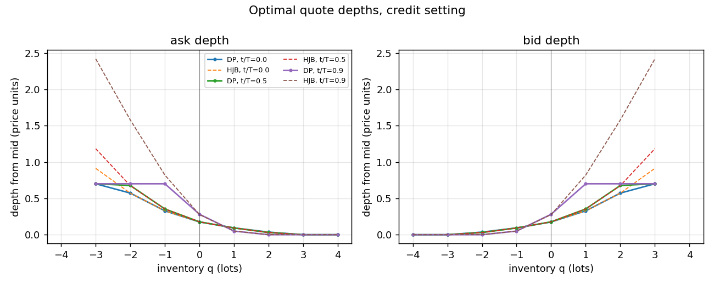

# Can RL learn to make markets? PPO vs the known optimum (equity and corporate-bond RFQ)

A market-making agent has to trade off two things at once: quote aggressively enough to earn
the spread, and get out of inventory before a price move hurts. That trade-off has a known
optimum in the classic exponential-fill model, and this repository uses that fact to measure
something usually left unmeasured: how close a plain reinforcement learning agent actually gets
to the best possible policy, and how much of the available edge it captures. The setting is
inspired by the market-making-plus-limit-order-book literature, but nothing here depends on
proprietary order book data: both markets are simulated from their fill intensities, so the
optimum can be computed exactly and the comparison is not a matter of opinion.

Equity: PPO recovers 91.0% +/- 2.4% (worst seed 87.6%) of the optimal policy's improvement over a tuned constant quote.

Credit: PPO recovers 56.6% +/- 34.2% (worst seed -0.7%) of the optimal policy's improvement over a tuned constant quote.





## Results

Equity setting, variance reduced reward:

| strategy | mean PnL (USD per 100 share lot per day) | 95% CI | PnL / std | efficiency | paired minus optimum | mean abs end of day q | fills per day |
| --- | --- | --- | --- | --- | --- | --- | --- |
| `dp_optimal` exact optimum (dynamic program) | 5832.6 | +-32.3 | 7.90 | 0.993 | n/a | 0.89 | 80.2 |
| `hjb_optimal` HJB solver policy | 5802.7 | +-31.3 | 8.13 | 0.974 | -29.9 +- 11.2 | 0.94 | 88.4 |
| `closed_form_cartea_jaimungal` textbook closed form | 5801.8 | +-31.3 | 8.12 | 0.973 | -30.8 +- 11.2 | 0.96 | 88.4 |
| `avellaneda_stoikov` Avellaneda-Stoikov heuristic | 5494.2 | +-29.2 | 8.25 | 0.775 | -338.4 +- 21.1 | 2.28 | 85.3 |
| `rl` RL, PPO, 5-seed mean | 5703.9 | +-31.2 | 8.02 | 0.910 | -128.7 +- 10.0 | 1.84 | 77.8 |
| `rl_worst_seed` RL, worst of the 5 seeds | 5650.7 | +-32.8 | 7.54 | 0.876 | -181.9 +- 18.5 | 1.78 | 69.6 |
| `naive_tuned` tuned constant quote (baseline) | 4294.9 | +-103.5 | 1.82 | 0.000 | -1537.7 +- 97.2 | 5.89 | 66.2 |

The Avellaneda-Stoikov heuristic approximates the optimum of a different objective, exponential
utility rather than the quadratic inventory penalty used here, so its lower score is not a case
of RL beating it.

Credit setting, variance reduced reward:

| strategy | mean PnL (USD per 1mm face lot per day) | 95% CI | PnL / std | efficiency | paired minus optimum | mean abs end of day q | fills per day |
| --- | --- | --- | --- | --- | --- | --- | --- |
| `dp_optimal` exact optimum (dynamic program) | 4751.3 | +-185.8 | 1.12 | 0.977 | n/a | 0.23 | 5.4 |
| `hjb_optimal` HJB solver policy | 4754.1 | +-185.5 | 1.12 | 0.977 | +2.8 +- 20.4 | 0.24 | 5.5 |
| `rl` RL, PPO, 5-seed mean | 2751.6 | +-112.1 | 1.08 | 0.566 | -1999.7 +- 119.7 | 0.31 | 3.5 |
| `rl_worst_seed` RL, worst of the 5 seeds | -33.3 | +-18.5 | -0.08 | -0.007 | -4784.6 +- 186.7 | 0.02 | 0.0 |
| `naive_tuned` tuned constant quote (baseline) | -0.8 | +-13.5 | -0.00 | 0.000 | -4752.2 +- 186.2 | 0.02 | 0.0 |

In the credit setting a tuned constant quote earns roughly nothing after inventory costs, so efficiency here is the share of the optimal policy's profit that RL captures.

## How it works

**The model, and why a known optimum makes RL measurable.** One dealer quotes a bid and an ask
around a mid price and is filled on each side by a Poisson process whose intensity falls with
the distance of the quote from the mid. Inventory causes risk, which is priced with a quadratic
running penalty `phi q^2` and a terminal penalty `a q^2`. The resulting objective is the
expected cash plus the marked inventory minus those penalties, and it can be optimised exactly.
With an optimum in hand, "the agent learned something reasonable" becomes checkable: efficiency
is `(J_RL - J_fixed) / (J_optimum - J_fixed)`, the share of the gap between a tuned constant
quote and the exact optimum that the agent closes. The agent is graded on 2000 held out
episodes that share price shocks and fill draws with every baseline (common random numbers), so
the comparison is paired, and five training seeds are reported as mean plus or minus a standard
deviation with the worst seed visible.

**Two exact solvers, cross-checked three ways.** The first is the Hamilton-Jacobi-Bellman
equation for the value function, `d/dt h = phi q^2 - lam H(h(q) - h(q-1)) - lam H(h(q) - h(q+1))`
with `H(p) = sup over d >= 0 of f(d)(d - p)`, integrated backwards with an analytic Jacobian.
The second is the exact dynamic program of the discretised simulator: because the mid price is a
martingale independent of the fills, the state is just `(step, inventory)` and the expected
objective satisfies a finite recursion that is solved exactly, with no Monte Carlo error. The
third is the textbook Cartea-Jaimungal matrix exponential for the exponential fill model. All
three agree where they should: the solver reproduces the closed form to 1e-9 at every grid point
once the depth floor is removed, and the dynamic program's own policy reproduces its value under
simulation within sampling error. One substantive finding came out of this cross-check, and it
is pinned by tests: **the floor at a zero depth changes the answer.** The optimum maximises over
`d >= 0`, and near the inventory limit the exact optimum quotes at the mid on the side that
reduces a position, where the exponential branch used by the textbook closed form is out of its
range. The closed form therefore solves a different, unfloored system: it matches the exact
solution to a few hundredths of a price unit near a flat book and differs by tens of units near
the inventory limit, so the benchmark uses the floored optimum everywhere.

**The credit market in dealer terms.** One lot is 1mm of face value, the price is quoted per 100
of face, and modified duration is 7 years, so DV01 is 700 USD per lot per basis point and one
basis point of spread is 0.07 price points. The dealer sees about 10 requests per side per day
and answers each with a two-way price; the probability that a side trades falls as that side's
quote moves away from the mid. Holding one lot for a whole day costs about 2.25 times the spread
earned on a single fill, so inventory risk is first order and the optimal policy quotes widely
on whichever side would make the position worse. The worked conversion of the calibration
target, inputs and outputs labelled:

```
inputs:  D = 7, target half-spread = 2.5 basis points
output:  price half-spread = D * 0.00025 * 100 = 7 * 0.00025 * 100 = 0.175 points
         in dollars = 0.175 * 10,000 = 1,750 USD of spread on one 1mm lot
```

The two hit-ratio parameters are not guessed. They are solved numerically so that the dynamic
program quotes exactly 0.175 points at `(t = 0, q = 0)`, which is 2.5 basis points, and the hit
ratio at that depth is 30 percent, and a test re-checks both targets.

## Key findings

1. **The zero-depth floor is not a detail.** With these parameters the exact optimum quotes at
   the mid on the reducing side once inventory is near its limit, where the textbook exponential
   fill-intensity formula is outside its valid range. The closed form disagrees with the exact
   solution by tens of price units there, so a benchmark that used the closed form as ground
   truth would be grading against the wrong policy.
2. **Exploration width decided whether the credit agent learned at all.** With the default
   initial policy standard deviation the sampled quotes span the whole action box, which for
   credit means almost every sample is a quote too deep to trade, and the agent then receives
   almost no signal. On two seeds at 300k steps, credit efficiency was 0.43 and 0.59 at the
   default and 0.94 and 0.78 once the initial standard deviation was tightened
   (`log_std_init = -1.0`). The same setting is used in both markets.
3. **Removing mean-zero marking noise from the training reward helps modestly and uniformly
   here, and was decisive in a wider-spread version of the credit market.** The realised step
   reward contains `q_{k+1} (S_{k+1} - S_k)`, a martingale increment independent of the fills, so
   it cannot move the optimum; it can and does swamp the learning signal. Training on the
   conditional mean instead of the realised reward moves the 5-seed mean efficiency from 0.875 to
   0.910 for equity and from 0.530 to 0.566 for credit in the current calibration. In the earlier
   calibration, where the half-spread was 1.4 basis points against a much larger position risk,
   the same change moved credit from 0.397 to 0.812. The two rows for each market are in the
   repository so the reader can see both.
4. **The agent is graded against an optimum it cannot see.** No reward scaling, callback or
   hyperparameter uses the optimum, the solver or the dynamic program: those appear only in
   evaluation, reporting and tests, and a test enforces that by parsing the trainer and the
   environment. Reward size during training comes from stable-baselines3 reward normalization,
   whose statistics are saved with the agent.

## Parameters

| parameter | equity | credit | unit | source |
| --- | --- | --- | --- | --- |
| `s0` | 100.0 | 100.0 | price (one share) | equity: Avellaneda and Stoikov (2008). credit: par bond at 100, ASSUMED |
| `sigma` | 2.0 | 0.28 | price units per unit time | equity: Avellaneda and Stoikov (2008). credit: ASSUMED, a spread volatility of 4 bp per day times 0.07 points per bp gives 0.28 points |
| `T` | 1.0 | 1.0 | time | equity: as in the paper. credit: one trading day |
| `dt` | 0.005 | 0.005 | time | equity: as in the paper. credit: same discretisation |
| `n_steps` | 200 | 200 | steps | T / dt |
| `lam` | 140.0 | 10.0 | arrivals per unit time | equity: Avellaneda and Stoikov (2008) A = 140. credit: ASSUMED, 10 requests per side per day for one liquid investment grade bond |
| `Q` | 20 | 4 | lots | chosen so the bound never binds: the optimal policy reaches |q| = 2 at most and spends no measurable time at the bound |
| `gamma` | 0.1 | 10.0446 | risk aversion | equity: Avellaneda and Stoikov (2008) numerical section. credit: derived from 0.5 gamma sigma^2 T = 2.25 * 0.175, i.e. holding one lot for a full day costs 2.25 times the half-spread earned on one fill |
| `phi` | 0.2 | 0.39375 | price per unit time per lot^2 | derived: 0.5 * gamma * sigma^2 |
| `a` | 0.2 | 0.39375 | price per lot^2 | derived: phi * T, so ending with q lots costs the same as holding q lots for the whole horizon |
| `a in bp of spread` | 2.86 | 5.62 | bp | same number expressed per basis point of spread: a / 0.07 |
| `usd_per_price_unit` | 100.0 | 10000.0 | USD | reporting only, it never enters the dynamics. equity: one unit of inventory is one share, reported per 100 share lot. credit: one lot is one million of face, quoted per 100 of face, so one price unit is 10000 USD per lot |
| `d_max` | 2.0 | 0.7 | price units | RL action bound, chosen inside the band that keeps the optimal depth at (t=0, q=0) between 20 and 50 percent of the range and a bound cost under 0.1 percent of the optimum; both are measured, see the README |
| `k` | 1.5 |  | 1 / price | Avellaneda and Stoikov (2008) |
| `alpha` |  | -1.627238 | dimensionless | SOLVED, not assumed: calibrated jointly with beta so that the dynamic program quotes a 2.5 bp half-spread at (t=0, q=0) and the hit ratio there is 30 percent. Hit ratio levels for investment grade RFQ are UNVERIFIED, see the README |
| `beta` |  | 14.140205 | 1 / price unit | SOLVED, not assumed: the slope follows from the first order condition beta (1 - f) d = 1 once alpha is fixed by the 30 percent hit ratio target |

## Reproduce

```bash
python -m venv .venv && source .venv/bin/activate
pip install -r requirements.txt
pytest -m "not slow"                       # fast tests, about a minute
pytest                                     # everything, about 4 minutes
python -m benchmark.run_all --quick         # smoke run, about a minute
python -m benchmark.run_all --ablation      # full run, about 35 minutes on a MacBook CPU
python check_readme.py                      # README against the recorded results
```

The full run trains five seeds per setting plus two five-seed ablations at 500k environment steps
each, evaluates every strategy on the same 2000 held out episodes, writes
`benchmark/results/summary.json` and redraws `figures/`. `check_readme.py` loads that file and
fails if any number printed above has drifted from the run that produced it.

## Limitations

* Both markets are synthetic. Fills depend only on the distance of a quote from the mid, so there
  is no adverse selection, no queue position, no partial fills, no fee or rebate schedule and no
  tick or lot size. Constant volatility is assumed.
* The credit calibration targets are prescribed for a liquid bond rather than measured: published
  one-way execution costs for typical institutional investment grade trades are 20 to 62 basis
  points, far wider than the 2.5 basis point half-spread calibrated here. Dealer-level hit ratios
  for liquid on-the-run bonds are not published anywhere that could be verified. See
  DECISIONS.md for what was verified, with sources and dates, and what is ASSUMED.
* The learning signal in the credit setting is sparse: about 5.4 fills per day at the
  optimum, so a few thousand episodes is thin. The credit result measures what plain PPO
  recovers from that, not the best achievable.
* The benchmark measures whether RL can learn a known policy. It is not evidence that the policy
  would make money in a real market.
